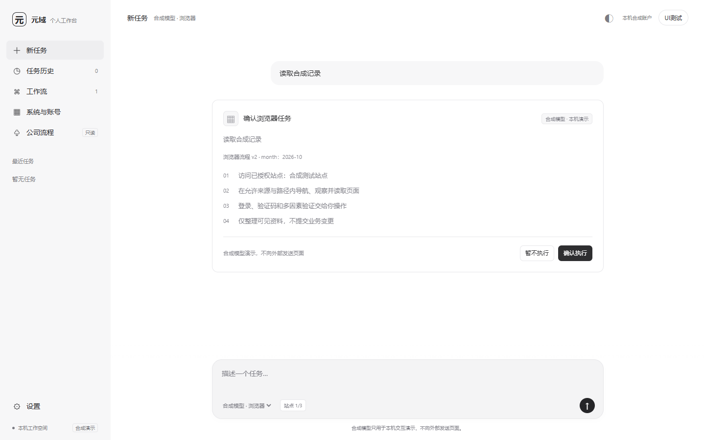
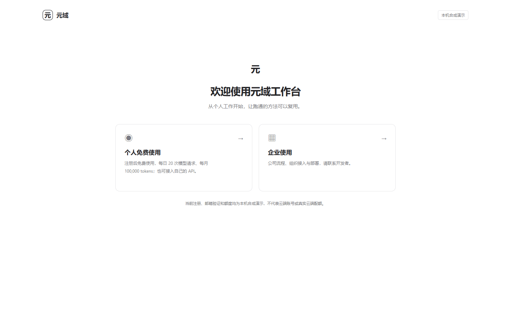
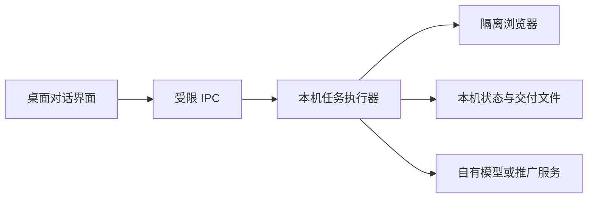

# 元域工作台 · Yuanyu Workbench

**面向个人业务工作的本机 AI Agent 工作台。**

[](LICENSE)


在一个对话入口中说明任务，由受控浏览器读取授权页面、整理资料并交付可核对的结果。把成功完成的只读操作保存为个人工作流，下次确认参数后再次运行。

[快速开始](#快速开始) · [核心能力](#核心能力) · [首次体验](#首次体验) · [使用指南](docs/GUIDE.md) · [开发计划](docs/PLAN.md)

> **当前为开发预览版。** 默认运行本机合成演示，无需真实模型密钥。Windows 桌面链路已验证；真实模型业务效果、生产 OA 和复杂企业页面适配仍在推进中。

## 项目预览



*工作台界面，使用隔离合成数据展示流程参数与执行前确认。*

<details>
<summary>查看个人版与企业版入口</summary>



</details>

## 元域希望解决什么问题

采购、运营、行政等日常工作，常需要在多个网页中反复筛选、复制、核对，再整理成文件。操作步骤容易重复，结果也需要保留来源以便复核。

元域将这类工作组织为一条可查看、可确认、可复用的任务链：

**说明目标 → 确认范围 → 登录授权站点 → 执行与核对 → 获取结果 → 保存个人工作流。**

目前可以通过采购与入库资料整理、合成记录查询体验这条链路；接入自己的站点时，需先配置允许访问的来源与路径。

## 核心能力

| 能力 | 当前实现 |
| --- | --- |
| 对话工作台 | 任务计划、逐步状态、历史记录、产物入口，以及深浅主题 |
| 受控浏览器 | 在选定站点内观察和执行有限只读操作，登录与 MFA 支持人工接管 |
| 教我做一次 | 在工作台选择查询、筛选等只读操作，核对结果后保存Skill；登录/MFA不记录，无需调用模型 |
| 个人工作流 Skill | 从成功任务保存只读步骤；支持置顶、改名、修订和查询参数化 |
| 多模型接入 | 选择推广服务模型，或管理本人的多个 API 配置；连接测试需单独确认 |
| 注册与额度 | 个人注册、验证、登录及撤权；服务端按账号限制请求次数与 Token 用量 |
| 资料交付 | 采购演示生成 CSV 与来源说明，金额按整数分核对，未匹配项明确列出 |
| 执行控制 | 支持暂停、继续、取消；过期引用可在重新观察后有界恢复，身份或来源变化时停止旧任务 |

工作流复用依赖已验证的操作和站点版本。当前不支持自动学习任意业务流程，也不承诺适配任意网站。

## 快速开始

### 环境要求

- **Node.js**：Node.js 24 及以上；当前完整验证使用 v24.14.1。
- **桌面环境**：当前完整回归在 Windows 上执行；macOS、Linux 尚未完成同等验证。
- **Electron**：项目固定使用 `43.7.9`，随开发依赖安装。

```bash
git clone https://github.com/shulinw27-web/yuanyu-workbench.git
cd yuanyu-workbench
npm ci
npm start
```

首次启动会打开个人版/企业版入口，并启动本机演示站点与账号服务。默认占用端口 `15331–15334`，端口冲突时需先处理占用。

如本机已有可用的 Electron，可通过 `YUANYU_ELECTRON_PATH` 指定其可执行文件。更多启动配置见[使用指南](docs/GUIDE.md)。

## 首次体验

### 运行浏览器任务并保存 Skill

1. 首页选择“个人免费使用”，注册邮箱、名称和至少 12 位密码。
2. 在“设置”输入页面显示的**合成校验码**，完成本机演示账号验证。
3. 回到“新任务”，选择“合成模型 · 浏览器”，输入：`读取2026-09合成记录`，查看并确认计划。
4. 在独立浏览器窗口中使用演示账号登录，完成合成 MFA。
5. 返回工作台点击“继续任务”，核对页面结果 `SYN-091`、`9087` 分。
6. 保存为个人浏览器工作流，之后可编辑查询参数并重新运行。

| 本机演示凭据 | 值 |
| --- | --- |
| 账号 | `demo` |
| 密码 | `interactive123` |
| 合成 MFA | `246810` |

以上均为仓库内置的合成演示数据，仅用于本机体验。

### 手工教一次，再按参数复用

点击输入框旁的“教我做一次”，确认目标与站点。登录后，在工作台选择月份和筛选控件并逐步执行，核对当前结果，再确认完成并保存为个人工作流。此过程不调用模型、不消耗推广额度。

以后可将成功的查询步骤设为参数，确认新参数后本机重放，无需配置模型。控件引用过期时最多重新观察并重试当前步骤一次，不重复之前已完成的操作。这是工作台内的受控示范，不直接录制网页中的任意点击；详细操作见[使用指南](docs/GUIDE.md)。

### 生成采购月报资料

在“系统与账号”中，为 Mock 采购、Mock 仓储分别保存演示账号 `demo` / `demo123`。选择“预设流程”，输入 `整理2026年10月采购月报`，确认后执行。

执行器会通过两个实际本机网页读取数据，按采购单号关联并生成 CSV 与来源说明。演示支持 `2026-09`、`2026-10` 两个月份，可用于验证参数复用与结果变化。产物为业务资料草稿，需由使用者复核。

## 模型与免费额度

支持 **Chat Completions 兼容 API**，内置 DeepSeek、智谱 GLM、千问、Kimi、火山方舟及自定义服务配置入口。原生 Anthropic、Gemini 协议尚未直接适配。

| 方式 | 如何使用 | 费用与额度 |
| --- | --- | --- |
| 本机合成演示 | 默认启动即可体验，不需要 API key | 不调用真实模型，使用合成响应验证操作链路 |
| 开发者推广服务 | 注册、验证后选择服务端开放的模型 | 默认每账号每天 20 次模型请求、每月 10 万 Token，可由运营者调整 |
| 自己的 API | 在“设置 → 模型”保存并选择本人的配置 | 不扣开发者推广额度，费用由本人的模型提供方计收 |

推广服务需要开发者另行部署 HTTPS 账号/推理服务并配置 API 与全局预算，当前仓库不附带可直接使用的公共云端服务。日/月额度按北京时间零点更新；一个多步骤任务可能产生多次模型请求。

保存或切换配置不会自动调用模型。连接测试、任务文本发送和页面内容发送分别需要相应确认。部署方式见[使用指南](docs/GUIDE.md)。

## 架构与数据边界



- **本机优先**：个人运行记录、工作流及文件默认保存在用户目录，仓库不存放运行数据。
- **凭据隔离**：业务账号与界面新增的模型密钥使用操作系统加密；远程业务网页没有 Node、preload 或工作台 IPC 能力。
- **明确外发范围**：模型只接收本次授权范围内的数据；任务文本授权不会自动扩大为页面内容授权。
- **服务端限额**：推广 API 密钥只由运营服务端使用，调用前检查账号额度和全局预算。
- **结果可核对**：执行步骤、资料来源及异常项可查看；模型摘要仍需与实际页面或交付物核对。

默认 Windows 数据目录为 `%LOCALAPPDATA%\YuanyuWorkbench`，可通过 `YUANYU_DATA_DIR` 指定仓库外目录。当前通用浏览器工具以只读为主；合成写入验证只保存本机演示草稿，不提交真实企业业务。

## 个人版与企业版

| 版本 | 定位 | 当前边界 |
| --- | --- | --- |
| 个人开源版 | 免费注册使用个人任务、工作流和模型接入；源码采用 MIT 许可 | 公司流程为只读公开示例，不能导入、发布或运行企业模板 |
| 企业版 | 面向组织身份、公司流程共享及业务集成 | 独立维护，不包含在本公共仓库；生产接入需进一步实施和验收 |

企业接入、合作或部署咨询：**微信 `wsltest`**。

个人开源版位于公共仓库的 `main` 与 `codex/personal`。版本范围及维护约定见[版本说明](docs/EDITIONS.md)。

## 开发与验证

| 命令 | 用途 |
| --- | --- |
| `npm start` | 启动桌面工作台与本机合成演示 |
| `npm test` | 运行核心、模型、账号、额度与执行规则测试 |
| `npm run check` | 检查 JavaScript 语法与文档本地链接 |
| `npm run test:desktop` | 运行 Electron、系统加密、实际网页与界面闭环回归 |
| `npm run pack` | 构建未签名便携开发包，输出到 `output/portable` |
| `npm run readiness -- --config <仓库外配置> --public-url <HTTPS入口>` | 只读部署预检，不联网或读取密钥内容 |
| `npm run model:eval -- --offline` | 检查固定配方验收题库，不调用模型 |
| `npm run service` | 独立启动账号与推广额度服务 |
| `npm run service:admin -- list` | 查看本机运营服务的账号列表 |

个人分支最近一次完整验证为 **219/219 项单测通过**，桌面闭环通过；具体环境、范围和限制见[测试报告](docs/TEST_REPORT.md)。这属于开发验证记录，生产环境仍需独立验收。

```text
src/
├── ui/          桌面对话界面
├── agent/       浏览器任务与个人 Skill
├── browser/     受控浏览器与操作策略
├── model/       模型配置、网关与工具循环
├── product/     个人账号与推广服务客户端
├── service/     账号、额度与服务端模型接入
├── core/        工作区与工作流状态
└── runtime/     资料交付、备份与合成写入
```

欢迎通过 [Issues](https://github.com/shulinw27-web/yuanyu-workbench/issues) 反馈问题或提交改进建议。复现材料请使用合成数据；提交代码前运行相关测试与 `npm run check`，不要上传凭据、业务页面原文或用户目录。

## 文档与后续方向

- [使用指南](docs/GUIDE.md)：演示操作、模型配置、推广服务部署与运营命令。
- [运维指南](docs/OPERATIONS.md)：部署样例、预检、运营数据库备份/恢复及人工账号找回。
- [开发计划](docs/PLAN.md)：唯一工作清单及尚未完成的能力。
- [模块契约](docs/CONTRACTS.md)：接口、状态及信任边界。
- [测试报告](docs/TEST_REPORT.md)：已执行验证与未验收项。
- [版本说明](docs/EDITIONS.md)：个人开源版与企业版的源码边界。

后续重点包括原生网页任意手势录制、工作流归纳、复杂企业页面适配、真实模型效果验证，以及生产发行与升级。进展以开发计划为准。

## 许可证

个人版采用 [MIT License](LICENSE)，允许使用、修改和分发，第三方依赖遵循各自许可证。源码开源不附带开发者购买的 API 密钥或公共云端服务额度。
