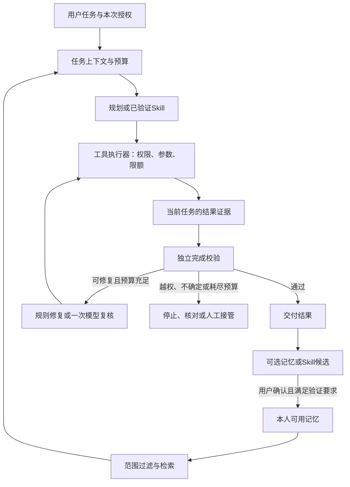

# 记忆、工具调用与自我修正设计方案

日期：2026-11-07。状态：用户已批准，按[唯一工作清单](PLAN.md)的M6/W24—W27顺序实施；各项完成与真实验收以清单和测试报告为准。

本方案服务于元域工作台现有的个人免费版、用户自带模型和后续企业版。目标是让用户少重复解释、让工作流可靠复用，并让系统在有限范围内发现和纠正错误。下文中的默认值是建议值，需要通过实现和评测确认。

## 1. 建议采用的整体方案

采用“分层记忆 + 统一工具执行 + 独立结果验证 + 有界自我修正”。首版继续使用一个主进程调度器，规划、验证和反思是职责分离，不要求启动多个模型或多个自治Agent。

三项能力形成一个闭环：按需取出经允许的记忆，建立本次目标和完成条件，调用受控工具，验证实际结果；发现可修复问题时有限修正，最后提出可供用户确认的经验。权限始终由可信运行时裁决。



以下机制互相独立：运行历史供人回看；长期记忆支持跨任务引用；Skill保存经过验证的操作方法。保存历史不自动授权模型读取历史，保存记忆也不授予网站或企业权限。

## 2. 当前项目基础与缺口

| 领域 | 已有基础 | 需要新增 |
| --- | --- | --- |
| 短期状态 | `src/agent/runtime.mjs`绑定身份、站点修订、attempt；模型消息仅在本次运行内累计 | 结构化工作上下文、按需组装和上下文预算 |
| 长期记录 | `src/agent/store.mjs`保存本人任务、有限轨迹和Skill；核心工作区保存固定业务运行 | 独立记忆类型、来源、有效期、冲突和遗忘机制 |
| 工具调用 | `src/model/tool-loop.mjs`有open/observe/act/handoff；每轮一个工具，运行时上限12轮/45秒 | 统一工具注册、严格契约、结果状态、证据和调用账本 |
| 结果判断 | 有最近非登录页面读取检查；固定采购报告有确定性校验 | 按用户目标、所有必要站点和产物判定完成 |
| 自我修正 | 已保存Skill遇执行前过期引用可重观察并重试一次 | 分类恢复策略、有限重规划、修正后复验 |

现有任务和轨迹属于受限明文元数据，并非全部加密的语义记忆库。新增记忆的加密方案不能被表述为现有所有运行数据已经整体加密。

## 3. 长短期记忆管理

### 3.1 记忆分层与建议默认值

| 层级 | 保存内容 | 生命周期与用途 |
| --- | --- | --- |
| 工作记忆 | 本次目标、用户硬约束、待办、已验证步骤、证据引用、剩余预算 | 当前任务内存；页面观察随导航/动作失效，任务结束清理；只持久化允许恢复的安全checkpoint |
| 任务情节记忆 | 脱敏的任务目的、结果类型、失败码和产物引用 | 新增摘要建议保留30天；跨任务检索需用户开启；不保存网页正文或报表明细 |
| 个人偏好 | “导出CSV”“金额保留两位”“默认月份使用上月”等 | 用户明确保存后生效，保留至删除；修改有版本，可建议定期复核 |
| 业务知识 | 用户确认的术语、字段含义、对账口径和适用范围 | 来源、站点/规则版本与有效期必填；普通事实建议7天后待复核，口径由用户明确有效期；动态金额、库存、审批状态必须重新查源系统 |
| 方法记忆 | 已保存Skill的步骤、参数、版本、来源凭证 | 沿用现有Skill机制；运行前重新校验权限和站点版本，正常重放不调用模型 |
| 经验候选 | “本次失败是月份筛选未生效，下次需检查结果月份” | 默认只形成候选，7天未确认清理；确认后可保留90天并绑定适用场景，不能自动修改Skill |

这些期限只适用于新增记忆层，不能直接给现有任务数组增加TTL删除。当前Skill必须关联本人已完成任务，历史清理需先解决来源依赖。

### 3.2 写入、纠正与遗忘

写入流程：候选提取 → 结构白名单和敏感信息检查 → 来源/范围/有效期校验 → 用户确认 → 版本化保存。用户明确说“记住这条偏好”可视为对该条内容的保存指令，界面提供撤销。候选优先来自结构化输入与本机规则；需要模型提取时必须计入本任务预算，不额外启动隐蔽的后台调用。

网页文字、工具返回和模型反思均不能直接变成可信长期规则。一次成功不证明方法普遍有效；只有满足完成条件的运行才可提出方法候选，Skill还需遵循原有保存与验证契约。

每条记忆至少包含：

```text
id, schemaVersion, revision
owner: companyId / userId                 # 来自可信身份，不能由模型指定
kind: preference / knowledge / episode / lesson
content                                 # 白名单字段组成的加密载荷
scope: siteIds / siteRevisions / workflowId?
source: user_message / verified_run / approved_document
sourceIds, evidenceIds, derivedFromIds
status: proposed / active / stale / superseded / deleted
createdAt, verifiedAt, expiresAt?
dataClass, externalUsePolicy
```

用户纠正时，新版本取代旧版本，并让依赖旧版本的摘要和检索缓存失效。历史偏好不能覆盖本次明确要求；历史业务事实与当前来源冲突时，展示差异并重新核实。重复检索不刷新验证日期或有效期。

删除分为“本次不用”“停用”“永久遗忘”。永久遗忘要清除该记录全部历史版本的有效载荷、候选、派生摘要和索引，取消尚未发送的相关模型请求；旧版本不能通过版本恢复重新生效。保留不含内容的最小删除标记以防当前库重新引用。已发送给提供方的内容无法通过本机删除撤回，相关外发范围必须事先说明。

### 3.3 检索与上下文组装

先按可信身份、当前授权、记忆状态、有效期、站点及版本过滤，再做本机关键词和任务关联排序。首版建议每次最多5条、合计约1500输入Token；达到上限时优先保留本次任务硬约束和当前证据，不挤掉必要工具结果。

首版采用本机结构字段与关键词检索，不引入外部向量数据库或自动Embedding调用。后续确需语义检索时单独评测；向量和Embedding也视为敏感派生数据，外发另需授权。

工作上下文建议固定为：目标与禁止事项、参数与时间范围、站点/Skill版本、完成条件、已验证进展、证据引用、相关记忆、下一步和预算。会话最近问答仅在短期内存，未解决的澄清、用户确认及参数来源另行结构化；跨会话只恢复安全checkpoint。短摘要用于导航和召回，不能替代业务证据。

压缩时保留原始用户硬约束，不让模型自行改写；优先丢弃失效观察和无关历史。工具调用与结果必须成对保留，不能截断协议消息。确需模型摘要时计入同一任务预算；免费模式默认使用结构化摘取，额外摘要不自动触发。

### 3.4 存储、隔离、备份和模型切换

建议新增仓库外`memory/<company>/<user>/state.json`，沿用单写者、原子替换和revision校验；记忆载荷使用现有OS加密适配能力，绑定本人及记录身份，最小明文元数据不得包含业务内容。本机授权后解密检索，不建立明文全文索引；加密不可用则不持久保存记忆。

凭据继续由独立凭据库保管，密码、API Key、Cookie、会话Token、验证码不进入记忆。结构白名单优先，敏感词扫描仅作辅助，不能宣称正则能识别所有秘密。

身份切换、撤权、记忆修订和站点变更均使相应上下文失效；请求前后复验，丢弃失效上下文的迟到结果。权限来自当前服务和运行时，不能从“记得以前能用”恢复。

本机记忆可以跨模型保留，但外发许可要绑定提供方、模型配置revision、任务和选定记忆范围。现有`task_text/selected_pages`同意不自动覆盖长期记忆；切换模型后清空旧请求上下文，并重新确认发送范围，不把旧模型的整段对话静默转发。

记忆备份须显式加入现有精确白名单，不能改为导出整个用户目录。旧备份可能包含后来遗忘的内容；首版恢复后所有长期记忆默认停用，用户检查后重新启用。仅随备份回滚的删除标记不能保证防止旧内容复活，自动恢复生效需未来独立删除账本。备份本身的清理和保留另行执行。

历史来源依赖的迁移建议：为Skill保存最小不可执行的来源凭证，保留原运行ID、完成校验、模板指纹及版本。迁移完成前，不自动删除被Skill引用的现有任务；界面说明依赖，并支持明确的级联删除。

## 4. 工具调用（Tool Use）

### 4.1 统一工具注册与执行

新增可信`ToolRegistry`，由应用代码注册工具。描述至少包括`name/version/inputSchema/outputSchema/effect/scope/timeout/retryPolicy/permission/evidenceContract`。运行时据本次授权生成模型可见工具列表；界面、模型或网页不能注册任意工具实现。

统一执行顺序：参数校验 → 身份/来源/版本/授权复验 → 预算检查 → 资源锁 → 工具执行 → 输出校验与脱敏 → 授权再次复验 → 记录结果和证据。调用前保存最小执行状态，未知回执与成功明确区分。

| 工具类别 | 首版策略 |
| --- | --- |
| 浏览器观察、导航和只读交互 | 首先迁移现有4个工具；只读点击仍受精确规则限制，HTTP GET本身不能证明无副作用 |
| 登录、凭据与MFA | 仍由可信主进程和人工接管；模型不能读取密码或自行处理验证码 |
| 本机计算、固定报告和文件产物 | 逐个注册确定性函数，只读受控输入，输出至已授权目录；不开放任意文件读写、脚本或Shell |
| 记忆与Skill | 检索返回当前本人可用条目；模型只可提出候选，保存/修改/发布仍由用户动作及既有校验控制 |
| 真实业务写入 | 后续单独接具体适配器，预览、明确确认、稳定幂等键、回执核对；普通浏览器工具继续拒绝提交 |
| 企业专用连接 | 仅在企业身份及服务端权限完成后启用；个人版记忆和工具不能打开企业流程 |

首版仍串行执行，避免同一浏览器会话并发导航或使用彼此失效的引用。以后只对经过验证、互不依赖的只读工具开放有限并发。

模型适配器和推广服务要同步版本化工具schema与允许列表。目前推广服务只接受固定名称；新工具不能只改本机注册表。服务端仍只代理模型调用，不执行本机工具；不支持的模型能力明确拒绝，不能降级为执行任意文本命令。

### 4.2 统一结果与完成条件

工具结果统一表达：`status = succeeded / failed / uncertain / awaiting_user / denied`，并带安全错误码、`effectState = not_started / observed / may_have_occurred`、工具版本、调用ID、证据ID和页面代次。证据ID由可信执行器生成，不能接受模型虚构的ID作为完成依据。

工具调用成功仅说明该调用得到受认可结果。任务完成还需独立`Verifier`检查本次目标：必要站点覆盖、参数/月份、必需字段、数据关联、计算一致性、文件实际存在与来源说明等。调用前明确必需来源，不要求读取任务选中但无关的全部网站。

完成条件由受信配方或用户确认的结构化目标决定，模型可以提出条件但不能执行后自行降低标准。开放式网页任务无法确定性验证时，结果标记“待用户核对”；模型复核可提示问题，不能单独升级为“已验证完成”。

## 5. 反思与自我修正（Reflection）

### 5.1 采用三个层次

1. 规则检查：每次重要工具操作后检查权限、参数、页面变化及结果结构；由本机代码执行，不消耗模型请求。
2. 目标复核：结束前由独立Verifier核对完成条件；固定业务优先确定性验证。
3. 有限模型复核：遇到有证据的差异、且明确可修复时，最多调用一次模型提出修正计划。默认不逐步追加critic调用；用户选择“加强复核”或任务已授权差异修复时才启用。

反思记录使用简短结构：`problemCode / evidenceIds / proposedCorrection / checkResult / nextAction`。不保存模型内部思维链；提供方协议必须携带的`reasoning_content`仍限于当前请求的短期内存，不进入记忆、日志或备份。

### 5.2 哪些可以修正，哪些必须停止

| 情况 | 策略 |
| --- | --- |
| 执行前已证明无动作发生的过期引用 | 沿用重新观察、唯一匹配、当前步骤最多重试一次；已成功步骤不重复 |
| 结果月份/筛选状态不符，当前权限内且没有副作用 | 可按预先声明的修复路径重做只读筛选并重新验证；一轮未解决则交还用户 |
| 工具参数格式错误、且未执行 | 可在剩余模型预算内纠正一次；不能通过删掉必需参数规避校验 |
| 登录/MFA、目标歧义、控件不唯一或页面结构不兼容 | 人工接管、澄清或停止；不能猜按钮或跨域找替代通道 |
| 撤权、身份/来源/站点修订/模型配置变化、取消 | 立即停止，丢弃迟到结果；反思不能恢复权限 |
| 策略拒绝、敏感字段、需要写入确认 | 拒绝或等待正式确认；不能换工具绕过 |
| 浏览器网络错误或超时 | 默认不重放可能已发生的动作；先核对状态，无法确定则停止 |
| 写入回执未知或执行中断 | 只按原幂等键核对，不能自动再次提交；上游不支持幂等时不能承诺一次写入 |
| 模型认证、付费、限流、超时或用量未知 | 保持现有不自动重试/不静默换模型策略，预留按既有服务规则处理 |

首版建议每任务最多一轮修正，最多一次额外模型复核。过期引用恢复也计入修正额度；确定性恢复和模型反思不能各开一套无限重试计数。相同错误/同一无变化状态再次出现即停止。

修复后的每项动作仍经过原工具策略、当前授权和Verifier，不能直接编辑永久Skill、白名单、预算或记忆。可复用的经验先形成候选，用户确认后生效。

## 6. 免费额度、模型能力与统一预算

推广免费版仍为每账号每天20次模型请求、每月10万Token；一个任务可能有多次模型调用。规划、摘要、复核、重规划与最终模型总结都计入同一模型预算和服务端额度，本机规则校验及Skill重放不扣模型额度。

建议初始设置如下，最终通过实测调整：

| 约束 | 建议 |
| --- | --- |
| 执行轮次/时间 | 以现有12轮/45秒为首版任务累计上限；人工等待不计主动执行时间，反思、继续或重启均不刷新上限 |
| 单任务模型请求 | 默认最多8次，包含正常工具循环中的模型调用；运行前可调低，需要更长任务时明确调整，首期上限12次 |
| 修正/额外复核 | 一轮修正、最多一次额外模型复核，共用上述请求/时间预算 |
| 记忆上下文 | 最多5条，约1500输入Token；还须满足整个请求的Token和字节硬上限 |
| 无模型路径 | 已保存Skill正常执行及规则性恢复保持0次模型调用 |

8次是起始设计值，不能被描述为已验证适合所有任务。当前多轮工具链通常需要多次请求，不能给一个看似节省但必然截断正常流程的过低默认值。任务开始前展示上限与当日剩余额度，剩余额度不足时先缩小计划、选择已验证Skill或停止。

主进程维护任务累计预算，网关限制请求，推广服务作最终配额裁决。人工接管暂停主动执行时间，但显式继续产生的新attempt沿用剩余主动执行时间；轮次、模型请求、Token和修正次数均跨attempt累计。重启、取消再继续不能自动刷新额度。追加预算只能由用户明确操作，并继续受账号/全局限制。

Token预估须按所选模型能力处理；未知分词器使用保守估算和硬字节上限，最终仍由提供方usage及服务端规则结算。Token上限不是人民币费用保证。BYOK遵循同样的任务预算与外发授权，不在推广额度用尽后自动切换。

## 7. 用户界面与一次运行示例

新增“记忆”管理入口，支持查看来源、适用范围、有效期、修改、停用和遗忘。设置中分别控制运行摘要留存、跨任务记忆引用、记忆外发和结果复核，避免用一个“自动学习”开关包办。

任务卡展示“本次用了哪些记忆”“计划使用哪些工具和网站”“最多多少次模型请求”；来源和外发范围变化时再次确认，范围内的普通步骤不重复弹窗。

修正发生时展示问题、动作和复验结果，例如：“结果仍是9月，已重新筛选10月，并核对结果月份。”失败时给出安全错误码、是否存在不确定操作和下一步。界面不显示内部推理，也不使用“自我学习完成”描述未经确认的候选。

以2026年11月执行“整理上月采购与入库资料”为例：

1. 取得当前时间/时区，将“上月”解析为2026-10；读取经确认的“CSV格式”“采购金额按分计算”偏好，明确两个必要来源和输出条件。
2. 如已有适用Skill，验证来源与版本后优先重放；否则在用户授权的模型与工具范围内规划。
3. 读取当前采购和入库数据，确定性关联/计算，不使用历史缓存金额作为本月事实。
4. 发现月份不一致时按允许路径修正一次；无法修正就报告差异。
5. 文件落盘、字段及来源校验通过后交付。新习惯或修复经验只作为可确认候选；下月仍重新读取业务数据。

## 8. 模块接入与兼容迁移

建议新增模块，名称仅作为实现方向：

| 模块 | 职责与接入点 |
| --- | --- |
| `src/memory/store.mjs`、`policy.mjs`、`retriever.mjs` | 记忆持久化、版本/范围/状态策略、本机检索；独立于任务数组 |
| `src/agent/context.mjs` | 构建WorkingContext、追踪引用与外发范围；接`runtime`和模型requester |
| `src/tools/registry.mjs`、`executor.mjs` | 首先包装现有4工具，生成严格schema并统一执行 |
| `src/agent/verifier.mjs` | 固定配方与开放任务的完成条件/证据检查 |
| `src/agent/recovery-policy.mjs`、`budget.mjs` | 分类恢复、修正次数、跨attempt累计预算 |
| 现有`store/runtime/gateway/promotion/UI/backup` | 版本化接线，保持原有权限、计费及恢复边界 |

迁移采用增量字段与显式schema升级；旧Skill保持原语义，缺少新证据的历史运行不得自动升级为“已验证”或自动生成长期记忆。备份恢复、新旧schema兼容及身份切换先有测试，再接UI。

个人版的记忆与受控工具框架可开源。未来企业共享知识走独立服务及当前成员权限，不能将个人记忆、运行记录或凭据自动上传；企业流程在个人版继续可看不可用。

## 9. 实施顺序与验收

先交付A，再依次推进B、C；以下为设计阶段划分，对应唯一工作清单M6/W24—W27，不在本文维护第二份完成清单。

| 阶段 | 交付范围 | 核心验收 |
| --- | --- | --- |
| A：可控基础 | WorkingContext、统一工具契约、任务预算、Verifier、用户明确保存的偏好及管理入口 | 当前流程不退化；记忆可查可改可删；完成判断有证据；正常Skill仍零模型调用 |
| B：有限修正 | 分类错误、单次修正、可选模型复核、经验候选、结构化事件记录 | 修正后重新验证；无重复写入、无越权绕过；不突破原请求和时间预算 |
| C：跨任务优化 | 摘要与有范围的检索、事实失效/冲突、Skill推荐、来源凭证迁移和遗忘恢复策略 | 旧事实不冒充当前证据；删除不再召回；比较成功率、费用及人工纠正次数 |
| 后续企业扩展 | 企业身份下的共享知识、工具目录和权限控制 | 跨公司拒绝、离职撤权、按最新授权检索；个人内容不自动共享 |

评测至少覆盖：跨账号/公司隔离；过期/停用/删除；用户纠正和冲突；网页提示注入及记忆污染；模型切换与旧授权失效；工具输出伪造；多站点仅读一站；修正循环；未知写入回执；撤权/取消竞态；预算跨attempt；旧备份恢复；Skill来源依赖。

回归集要求无越权工具执行、无越界记忆返回、无未知回执自动重提、无预算超限。收益采用相同任务和相同模型的对照测试，比较目标通过率、错误完成率、人工纠正次数、请求/Token和耗时；只有收益证据充分后才扩大自动反思范围。合成测试不能证明真实网站、真实模型和实际岗位已通过。

方案阶段不需要服务器、API密钥或额外付费服务。A阶段及B阶段的策略和交互可先用合成数据实现；真实效果评测仍需后续选择模型、网站、业务流程和明确费用预算。

## 10. 设计依据

本方案是结合当前项目边界作出的工程设计，不是对论文效果的直接保证。ReAct提供规划与外部行动交替的思路，本项目把可执行行动及结果判断放在受控运行时：[ReAct论文](https://arxiv.org/abs/2210.03629)。

Reflexion研究将任务反馈转化为后续尝试可用的语言经验；这里增加候选确认、适用范围、有效期与验证，不允许一次模型自评直接成为长期规则：[Reflexion论文](https://arxiv.org/abs/2303.11366)。

按需检索和压缩上下文的取舍参考Anthropic官方对上下文管理的讨论；本方案选择本机结构化上下文和小规模检索，并保留用户硬约束及工具协议完整性：[Effective context engineering for AI agents](https://www.anthropic.com/research/effective-context-engineering-for-ai-agents)。
